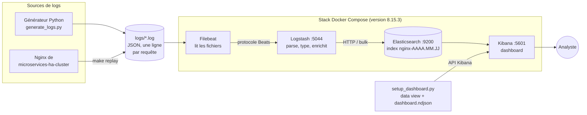

# elk-log-monitoring

> **EN —** A lightweight ELK stack (Elasticsearch, Logstash, Kibana 8.15.3 + Filebeat) that collects, parses and visualizes Nginx JSON access logs.
> It ships with a log generator and an auto-imported Kibana dashboard that makes a simulated brute-force attack stand out within seconds.

Stack **ELK + Filebeat** qui centralise les logs d'accès Nginx, les transforme, les indexe et les affiche dans
un dashboard Kibana. Le dashboard permet de **détecter une attaque par force brute** au milieu du trafic normal.
L'ensemble se lance avec une seule commande et tourne sur un portable.

<!-- Capture à ajouter : retirer les marqueurs de commentaire une fois l'image dans docs/images/

-->

## Sommaire

- [Objectif](#objectif)
- [Architecture](#architecture)
- [Rôle de chaque composant](#rôle-de-chaque-composant)
- [Prérequis](#prérequis)
- [Lancement en 3 commandes](#lancement-en-3-commandes)
- [Commandes](#commandes)
- [Scénario de démonstration](#scénario-de-démonstration)
- [Le pipeline en détail](#le-pipeline-en-détail)
- [Sécurité : lab local et production](#sécurité--lab-local-et-production)
- [Structure du dépôt](#structure-du-dépôt)
- [Dépannage](#dépannage)
- [Ce que j'ai appris](#ce-que-jai-appris)
- [Limites et améliorations](#limites-et-améliorations)

Les notions de base (index, document, mapping, pipeline…) et 10 questions d'entretien sont expliquées dans
[docs/EXPLICATIONS.md](docs/EXPLICATIONS.md).

## Objectif

Montrer, sur un cas concret, les bases de l'**observabilité** et de la **détection d'incidents** à partir des logs :

1. **collecter** les logs d'un serveur web sans toucher à l'application (Filebeat) ;
2. les **transformer** en données structurées et typées (Logstash) ;
3. les **indexer** pour pouvoir chercher et agréger rapidement (Elasticsearch) ;
4. les **visualiser** et **enquêter** dessus (Kibana) ;
5. **repérer une attaque** : beaucoup de `POST /login` refusés depuis une même IP.

Les logs utilisés ont le même format JSON que le Nginx de mon projet
[microservices-ha-cluster](https://github.com/tajedinesidimohamed/microservices-ha-cluster). Ce projet peut
donc lire ses vrais logs, ou fonctionner seul grâce à un générateur de trafic.

## Architecture



Le flux d'une ligne de log :

1. Nginx (ou le générateur) écrit une ligne JSON dans `logs/access.log`.
2. **Filebeat** détecte la nouvelle ligne et l'envoie à Logstash.
3. **Logstash** la découpe en champs : il convertit les types, calcule de nouveaux champs et ajoute un tag si
   c'est une connexion échouée.
4. **Elasticsearch** stocke le document dans l'index du jour, `nginx-AAAA.MM.JJ`.
5. **Kibana** interroge Elasticsearch et met le dashboard à jour toutes les 10 secondes.

## Rôle de chaque composant

| Composant | Rôle dans ce projet | Port | Mémoire mesurée |
|---|---|---|---|
| **Filebeat** | Agent léger qui surveille `logs/*.log` et envoie chaque nouvelle ligne à Logstash. Il retient sa position dans chaque fichier : pas de doublon après un redémarrage. | — | ~130 Mo |
| **Logstash** | Moteur de transformation : parsing JSON (ou `grok` pour le format texte), date, conversion des types, champs calculés (`status_family`, `response_time_ms`, tag `failed_login`), puis envoi vers Elasticsearch. | 5044 (interne) | ~550 Mo |
| **Elasticsearch** | Base de données orientée documents et moteur de recherche. Il stocke les logs dans des index journaliers et répond aux recherches et agrégations. | 9200 | ~1,5 Go (tas JVM 1 Go) |
| **Kibana** | Interface web : exploration (*Discover*), visualisations Lens et dashboard. | 5601 | ~950 Mo |
| `generator/generate_logs.py` | Génère du trafic Nginx réaliste, une attaque par force brute, ou rejoue les logs de `microservices-ha-cluster`. | — | — |
| `kibana/setup_dashboard.py` | Crée la data view `nginx-*` et importe le dashboard versionné `kibana/dashboard.ndjson`. | — | — |

Les 4 services utilisent exactement la même version, **8.15.3** (jamais `latest`). Chacun a un *healthcheck*,
et ils démarrent dans l'ordre : Elasticsearch → Logstash → Filebeat, et Elasticsearch → Kibana.

## Prérequis

| Élément | Minimum |
|---|---|
| **RAM** | Machine de 8 Go. La stack consomme environ **3,1 Go** en tout. Docker Desktop doit disposer d'au moins **4 Go** (sous WSL2, réglable dans `%UserProfile%\.wslconfig`, par exemple `memory=6GB`). |
| Disque | Environ 3 Go pour les images Docker, plus quelques Mo de données |
| Docker | Docker Desktop (WSL2 sous Windows) ou Docker Engine, avec Docker Compose v2.17 ou plus récent (option `--wait`) |
| Python | Python 3.8 ou plus récent, **aucune dépendance** : les scripts n'utilisent que la bibliothèque standard |
| Make | GNU Make (facultatif : chaque commande `make` correspond à une commande `docker compose` ou `python`) |
| Ports libres | `9200` (Elasticsearch) et `5601` (Kibana), exposés uniquement sur `127.0.0.1` |

## Lancement en 3 commandes

```bash
git clone https://github.com/tajedinesidimohamed/elk-log-monitoring.git && cd elk-log-monitoring
make up         # lance la stack et importe le dashboard (~1 min 30)
make generate   # 500 requêtes normales sur les 30 dernières minutes
```

Ouvrir ensuite le dashboard : <http://localhost:5601/app/dashboards#/view/nginx-log-monitoring>

- Au **premier** lancement, il faut compter quelques minutes de plus pour télécharger les images (environ 3 Go).
- Le fichier `.env` est **facultatif** : sans lui, les valeurs par défaut s'appliquent. Pour changer les ports,
  la mémoire ou le chemin des logs de `microservices-ha-cluster`, copier `.env.example` en `.env` et l'adapter.

Sans `make`, les commandes équivalentes sont :

```bash
docker compose up -d --wait
python kibana/setup_dashboard.py
python generator/generate_logs.py
```

## Commandes

| Commande | Effet |
|---|---|
| `make up` | Lance la stack, attend que les 4 services soient sains et importe le dashboard |
| `make down` | Arrête la stack (les données Elasticsearch sont conservées) |
| `make generate` | Génère 500 requêtes normales réparties sur les 30 dernières minutes |
| `make traffic` | Génère du trafic normal en continu, 5 req/s (Ctrl+C pour arrêter) |
| `make attack` | Simule une attaque par force brute : 300 `POST /login` en 401 depuis `203.0.113.66` |
| `make replay` | Rejoue les logs Nginx du projet `microservices-ha-cluster` |
| `make dashboard` | Recrée la data view `nginx-*` et réimporte le dashboard |
| `make status` | État des conteneurs et des index `nginx-*` |
| `make logs` | Suit les logs des conteneurs |
| `make clean` | Supprime conteneurs, volumes et logs générés (remise à zéro) |

- `make help` affiche cette liste.
- Le `Makefile` n'utilise que `docker compose` et `python` : il fonctionne dans PowerShell, Git Bash, WSL et Linux.
- Le générateur a d'autres options (`--count`, `--rate`, `--attacker-ip`, `--seed`…) : voir
  `python generator/generate_logs.py --help`.

## Scénario de démonstration

Objectif : montrer qu'on repère une attaque par force brute en quelques secondes, au milieu d'un trafic normal.

### 1. Trafic normal

```bash
make up
make generate
make traffic      # facultatif, dans un second terminal : trafic en direct
```

Ouvrir le dashboard (fenêtre « Last 1 hour », rafraîchi toutes les 10 s). Ce qu'on observe :

- un trafic régulier, très majoritairement en **2xx** (vert) ;
- quelques **4xx** isolés : scans de `/wp-admin` ou `/.env` (404), utilisateurs qui se trompent de mot de passe (401) ;
- le panneau **« Tentatives de connexion échouées par IP »** ne montre que 1 ou 2 échecs par IP : c'est le bruit normal.

<!-- Capture à ajouter :

-->

### 2. L'attaque

```bash
make attack
```

Le générateur écrit 300 `POST /login` refusés (401) depuis une seule IP, `203.0.113.66`, en 2 minutes,
avec le user-agent de l'outil de force brute THC-Hydra. Moins de 30 secondes plus tard, le dashboard change :

| Panneau | Signal |
|---|---|
| **Connexions échouées** (KPI rouge) | le compteur fait un bond d'environ +300 |
| **Requêtes dans le temps** | un pic de **4xx** (jaune) sur les 2 dernières minutes |
| **Répartition des codes HTTP** | la part de **401** explose |
| **Tentatives de connexion échouées par IP** | une barre rouge écrase toutes les autres : **203.0.113.66** |
| **Top 10 des IP** | l'attaquant passe en tête, devant les vrais clients |
| **Top des URL en erreur** | `/login` en 401 arrive en première ligne |

<!-- Capture à ajouter :

-->

### 3. L'enquête dans Kibana

1. **Filtrer sur l'attaquant** : cliquer sur la barre `203.0.113.66` dans le panneau des échecs de connexion.
   Le filtre s'applique à tout le dashboard : uniquement des `POST /login`, uniquement des 401.
2. **Lire les événements bruts** dans *Discover* (data view « Logs Nginx ») avec la requête KQL :
   ```
   remote_addr : "203.0.113.66"
   ```
   Ce qu'on y lit : user-agent `Mozilla/4.0 (Hydra)`, environ 150 requêtes par minute, toujours la même URL.
3. **Comparer avec le bruit normal** :
   ```
   tags : failed_login and not remote_addr : "203.0.113.66"
   ```
   Seulement quelques échecs isolés, répartis sur plusieurs IP et dans le temps.

**Conclusion** : beaucoup d'échecs d'authentification, une seule source, un délai très court et un client
automatisé. C'est la signature d'une attaque par force brute (MITRE ATT&CK
[T1110](https://attack.mitre.org/techniques/T1110/)).

<!-- Capture à ajouter :

-->

### 4. Et en production ?

La démo s'arrête à la détection. En production, on enchaînerait avec :

- **alerter** : une règle Kibana du type « plus de 20 échecs de connexion par IP en 1 minute » ;
- **bloquer** : `deny` Nginx, pare-feu ou `fail2ban` sur l'IP ;
- **prévenir** : limitation de débit sur `/login` (`limit_req` Nginx), verrouillage de compte, MFA.

### 5. Bonus : les logs du projet microservices-ha-cluster

```bash
make replay
```

Cette commande recopie `../microservices-ha-cluster/logs/access.log` (chemin réglable dans `.env` avec
`MICROSERVICES_LOGS`), en les horodatant à l'heure actuelle. Dans le dashboard, le filtre
`log_origin : "microservices-ha-cluster"` isole ces vrais logs du load balancer Nginx.

### Fin de la démo

```bash
make down    # arrêt, données conservées
make clean   # remise à zéro complète
```

## Le pipeline en détail

Le fichier [logstash/pipeline/nginx.conf](logstash/pipeline/nginx.conf) est commenté ligne par ligne. Il suit
le schéma **input → filter → output** :

| Étape | Ce qui est fait |
|---|---|
| `input` | Réception des événements Filebeat (protocole Beats, port 5044) |
| Parsing | `json` si la ligne commence par `{`, sinon `grok` (format texte « combined » de Nginx ou Apache) |
| `date` | L'heure de la requête (`time`) devient `@timestamp`, le champ utilisé par Kibana pour l'axe du temps |
| Types | `status`, `bytes_sent` et `request_time` sont convertis en nombres |
| Enrichissement | `status_family` (2xx…5xx), `response_time_ms`, `log_origin`, `ua.*` (navigateur, OS) et le tag `failed_login` sur les `POST /login` en 401 ou 403 |
| Nettoyage | Suppression des métadonnées Filebeat inutiles. La ligne brute n'est gardée qu'en cas d'échec du parsing. |
| `output` | Index journaliers `nginx-AAAA.MM.JJ` |

Les types des champs sont fixés par un **index template**,
[logstash/templates/nginx-template.json](logstash/templates/nginx-template.json), que Logstash installe au
démarrage :

| Champ | Type | Pourquoi |
|---|---|---|
| `remote_addr` | `ip` | Recherches par plage d'adresses (`remote_addr : "192.0.2.0/24"`) |
| `status` | `short` | Filtres numériques (`status >= 400`) |
| `request_time`, `response_time_ms` | `float`, `integer` | Moyennes et percentiles |
| `uri`, `method`, `status_family`, `user_agent`… | `keyword` | Agrégations exactes (top 10, camemberts) |
| Réglages | 1 shard, 0 réplica | Un seul nœud : un réplica ne pourrait pas être placé, l'index resterait « yellow » |

## Sécurité : lab local et production

> ⚠️ **Dans ce lab, la sécurité X-Pack est désactivée** (`xpack.security.enabled=false`) : pas
> d'authentification, pas de TLS entre les composants. C'est un choix volontaire, pour un usage **local
> uniquement**.

Ce qui limite le risque ici :

- Elasticsearch et Kibana ne sont exposés que sur `127.0.0.1` : ils sont inaccessibles depuis le réseau ;
- le port Logstash 5044 n'est pas exposé : il n'est joignable que depuis le réseau Docker ;
- le dépôt ne contient aucun secret : `.env.example` est fourni et `.env` est ignoré par Git.

**Pour passer en production**, il faut au minimum :

1. **Activer la sécurité d'Elasticsearch** et définir les mots de passe dans `.env`, jamais dans le dépôt :
   ```yaml
   # docker-compose.yml, service elasticsearch
   - xpack.security.enabled=true
   - ELASTIC_PASSWORD=${ELASTIC_PASSWORD}
   - xpack.security.http.ssl.enabled=true
   - xpack.security.transport.ssl.enabled=true
   ```
   Les certificats se génèrent avec `bin/elasticsearch-certutil` (une autorité de certification, puis un
   certificat par nœud).
2. **Kibana** : se connecter avec l'utilisateur `kibana_system` (`ELASTICSEARCH_USERNAME` /
   `ELASTICSEARCH_PASSWORD`), faire confiance à la CA (`ELASTICSEARCH_SSL_CERTIFICATEAUTHORITIES`) et définir
   `XPACK_ENCRYPTEDSAVEDOBJECTS_ENCRYPTIONKEY` (32 caractères minimum, nécessaire aux alertes).
3. **Logstash** : un utilisateur dédié, avec un rôle limité à l'écriture sur `nginx-*` (moindre privilège).
   Dans la sortie : `user`, `password`, `ssl_enabled => true`, `ssl_certificate_authorities`.
4. **TLS Filebeat → Logstash** : `ssl_enabled`, `ssl_certificate` et `ssl_key` dans l'input `beats`, et
   `ssl.certificate_authorities` dans `output.logstash` de Filebeat.
5. **Accès** : Kibana derrière un reverse proxy HTTPS, Elasticsearch jamais exposé sur Internet, et des
   comptes nominatifs avec des rôles adaptés (lecture seule pour les analystes).

## Structure du dépôt

```
elk-log-monitoring/
├── docker-compose.yml           # les 4 services, healthchecks, volumes
├── .env.example                 # version, ports, mémoire JVM, chemin des logs externes
├── Makefile                     # make up / generate / attack / dashboard / clean…
├── filebeat/filebeat.yml        # lecture de logs/*.log, envoi vers Logstash
├── logstash/
│   ├── config/logstash.yml      # réglages généraux de Logstash
│   ├── pipeline/nginx.conf      # pipeline commenté ligne par ligne
│   └── templates/nginx-template.json  # mapping des index nginx-*
├── generator/generate_logs.py   # trafic normal, attaque, rejeu des logs externes
├── kibana/
│   ├── setup_dashboard.py       # data view + import du dashboard
│   └── dashboard.ndjson         # dashboard Lens versionné
├── logs/                        # logs lus par Filebeat (ignorés par Git)
└── docs/
    ├── EXPLICATIONS.md          # notions clés et questions d'entretien
    └── images/                  # captures d'écran
```

## Dépannage

| Symptôme | Cause probable et solution |
|---|---|
| Elasticsearch redémarre en boucle (code 137) | Pas assez de mémoire pour Docker : augmenter la mémoire de WSL2 (4 Go minimum) ou réduire `ES_JAVA_OPTS` dans `.env` |
| `make up` attend longtemps Kibana | Normal au premier démarrage (jusqu'à 1 à 2 minutes). Suivre avec `make logs`. |
| Le dashboard est vide | Vérifier la fenêtre de temps (« Last 1 hour ») et que les documents existent avec `make status`. Relancer `make generate`. |
| Rien n'arrive après `make generate` | `docker compose logs filebeat logstash` ; vérifier que `logs/access.log` existe bien |
| Erreur à l'import du dashboard | Kibana pas encore prêt : relancer `make dashboard` |
| Port 9200 ou 5601 déjà utilisé | Changer `ES_PORT` / `KIBANA_PORT` dans `.env` |

## Ce que j'ai appris

- **Le mapping se décide avant d'indexer.** Sans template, Elasticsearch devine les types : une IP devient
  du texte, et un code HTTP peut finir en chaîne. Un type ne se modifie pas sur un index existant (il faut
  réindexer), d'où l'intérêt d'un index template versionné.
- **`@timestamp` doit venir du log, pas de l'heure d'ingestion.** Sinon, des logs rejoués ou arrivés en
  retard sont placés au mauvais endroit sur l'axe du temps.
- **Typer les champs, c'est ce qui rend l'analyse possible** : un temps de réponse stocké en texte ne permet
  pas de calculer une moyenne, une IP en `keyword` ne permet pas de chercher une plage.
- **Enrichir à l'ingestion simplifie la détection.** Le tag `failed_login`, posé par Logstash, rend le
  panneau anti-force brute trivial : un simple filtre et une agrégation par IP.
- **Filebeat garde une position de lecture (registre)** : après un redémarrage, il reprend là où il s'était
  arrêté, sans doublon ni perte.
- **Démarrer une stack dans le bon ordre** : `depends_on` avec `condition: service_healthy` et de vrais
  healthchecks, plutôt que des `sleep`.
- **Faire tenir ELK sur un portable** : limiter le tas JVM (`-Xms`/`-Xmx` identiques), désactiver le machine
  learning, mettre 0 réplica sur un nœud unique.
- **Versionner un dashboard Kibana** : un export `ndjson` importé par l'API saved objects. J'ai découvert que
  sans les champs de version de migration, Kibana applique toutes les migrations depuis la 7.x et l'import
  échoue.
- **Écrire des outils portables Windows / Linux** : un `Makefile` sans commandes propres à un shell, des scripts
  Python sans dépendance, des fins de ligne LF forcées par `.gitattributes`.
- **La démarche d'enquête** : partir d'un signal agrégé (le KPI), isoler la source (clic sur l'IP), puis
  confirmer dans les événements bruts (Discover, KQL).

## Limites et améliorations

| Limite actuelle | Amélioration possible |
|---|---|
| **Pas de sécurité** (ni authentification ni TLS entre composants) | Activer X-Pack, TLS sur toutes les liaisons, rôles au moindre privilège (voir [Sécurité](#sécurité--lab-local-et-production)) |
| **Pas d'alerte** : la détection reste visuelle | Règle Kibana (seuil d'échecs de connexion par IP) avec notification e-mail, Slack ou webhook ; ou ElastAlert 2 |
| **Pas de rétention** : les index journaliers s'accumulent | Politique **ILM** (Index Lifecycle Management), par exemple suppression après 7 jours, rattachée au template via `index.lifecycle.name` |
| **Un seul nœud**, 0 réplica : pas de haute disponibilité | Cluster de 3 nœuds avec réplicas, et snapshots vers un stockage objet |
| Détection par seuil simple | Corrélation dans le temps (fenêtres glissantes), règles de détection Elastic Security, détection d'anomalies |
| IP de démonstration (RFC 5737) : pas de géolocalisation | Filtre `geoip` dans Logstash et carte des sources dans Kibana sur de vraies IP |
| Logstash est le composant le plus gourmand | Pipelines d'ingestion Elasticsearch ou décodage JSON directement dans Filebeat pour les cas simples |
| Logs d'accès uniquement | Ajouter les logs d'erreur Nginx, les métriques (Metricbeat) et les traces (APM) pour une observabilité complète |

## Licence

[MIT](LICENSE) © 2026 Taje Dine Sidi Mohamed
